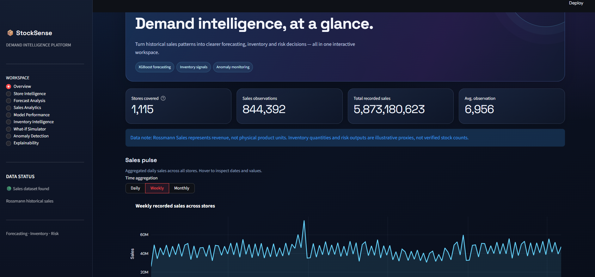
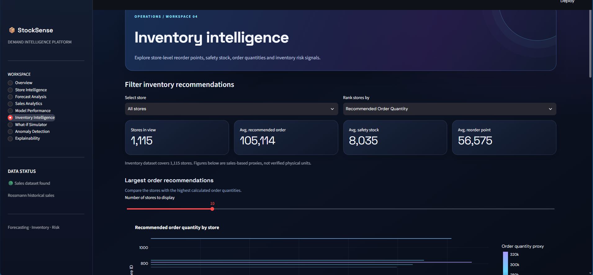

# StockSense — Demand Forecasting & Inventory Intelligence

**An end-to-end retail analytics project combining machine learning, time-series forecasting, inventory planning, anomaly detection, and interactive data visualization.**

StockSense transforms historical retail sales data into demand insights through machine learning, store-level performance analysis, inventory planning calculations, and an interactive Streamlit dashboard.

> **Project Status:** Research prototype with historical model evaluation, inventory analysis, and interactive what-if scenarios.

## Dashboard Preview

### Overview


### Forecast Analysis


### Inventory Intelligence


## Table of Contents

- [Overview](#overview)
- [Key Features](#key-features)
- [Technology Stack](#technology-stack)
- [System Architecture](#system-architecture)
- [Dataset](#dataset)
- [Model Evaluation](#model-evaluation)
- [Inventory Planning](#inventory-planning)
- [Anomaly Detection and Explainability](#anomaly-detection-and-explainability)
- [Project Structure](#project-structure)
- [Getting Started](#getting-started)
- [Testing](#testing)
- [Limitations](#limitations)
- [Future Scope](#future-scope)
- [Learning Outcomes](#learning-outcomes)
- [Author](#author)

## Overview

Retail businesses need reliable demand estimates to plan inventory, understand sales patterns, and make informed stocking decisions. StockSense explores how machine learning and analytical methods can support these decisions using historical retail sales data.

The project brings together data preparation, exploratory analysis, forecasting experiments, model evaluation, inventory calculations, anomaly detection, explainability, and interactive visualization in one application.

### Project Objectives

- Analyze historical sales patterns across retail stores.
- Build and evaluate machine learning models for sales prediction.
- Compare model performance using standard regression metrics.
- Explore inventory planning through safety stock and reorder-point calculations.
- Flag unusual historical sales observations for further investigation.
- Present analytical results through an interactive dashboard.

## Key Features

- **Sales Analytics:** Explore historical sales patterns across stores and time periods.
- **Demand Forecasting:** Train and evaluate Random Forest and XGBoost regression models using time-based validation.
- **Model Evaluation:** Compare forecasts using MAE, RMSE, and sMAPE.
- **Store Intelligence:** Inspect store-level performance, prediction errors, and anomaly summaries.
- **Inventory Planning:** Calculate illustrative safety stock, reorder points, target stock levels, and order quantities.
- **Anomaly Detection:** Flag unusual historical sales observations for further investigation.
- **Model Explainability:** Visualize global feature-importance rankings.
- **What-if Simulation:** Explore how changes in demand, lead time, and service level affect inventory calculations.
- **Interactive Dashboard:** Filter, visualize, inspect, and export analytical results through Streamlit and Plotly.

## Technology Stack

| Category | Technologies |
|---|---|
| Programming Language | Python |
| Data Analysis | Pandas, NumPy |
| Machine Learning | Scikit-learn, XGBoost |
| Time-Series Analysis | Statsmodels |
| Data Visualization | Plotly |
| Dashboard | Streamlit |
| Testing | Pytest |
| Version Control | Git, GitHub |
| Development Environment | VS Code |

## System Architecture

StockSense follows an analytical pipeline:

1. **Data Preparation:** Clean and aggregate historical sales observations.
2. **Exploratory Data Analysis:** Study sales distributions, temporal patterns, and store-level differences.
3. **Feature Engineering:** Create calendar features, lagged sales, and rolling statistics using past observations.
4. **Forecasting:** Train global machine learning models and evaluate them on a temporal holdout.
5. **Model Evaluation:** Compare predictions and analyze errors across stores.
6. **Inventory Intelligence:** Calculate safety stock, reorder points, target stock, and illustrative order quantities.
7. **Risk and Explainability:** Flag unusual observations and inspect feature importance.
8. **Dashboard:** Present results through interactive charts, filters, tables, and CSV exports.

## Dataset

StockSense uses the **Rossmann Store Sales** dataset.

The dataset contains historical sales information for Rossmann retail stores. The project uses processed store-level daily sales and engineered features for forecasting and analysis.

**Dataset source:** [Rossmann Store Sales — Kaggle](https://www.kaggle.com/c/rossmann-store-sales/data)

### Important Data Consideration

The dataset's `Sales` field represents monetary sales turnover, not physical product units. Consequently, inventory calculations in this prototype use sales-based proxies and must not be interpreted as verified quantities to order.

Processed CSV files are generated through the project's notebooks and stored under `data/processed/`.

## Model Evaluation

The global forecasting experiments use a time-based evaluation split to preserve temporal ordering.

| Model | MAE | RMSE | sMAPE |
|---|---:|---:|---:|
| Random Forest | 710.63 | 1,036.48 | 10.51% |
| XGBoost | 697.11 | 999.25 | 10.32% |

### Current Candidate: XGBoost

On the reported global holdout, XGBoost achieved lower MAE, RMSE, and sMAPE than Random Forest.

These results describe the project's saved evaluation run. They do not guarantee future performance. Metrics should only be compared when models use compatible targets, data splits, and evaluation procedures.

The project also includes naive forecasting, seasonal naive forecasting, ARIMA, and SARIMA experiments. Those experiments used a separate single-store evaluation setup and should not be directly compared with the global multi-store model results.

### Evaluation Metrics

- **MAE (Mean Absolute Error):** Measures the average absolute difference between actual and predicted values.
- **RMSE (Root Mean Squared Error):** Penalizes larger prediction errors more heavily.
- **sMAPE (Symmetric Mean Absolute Percentage Error):** Measures prediction error relative to actual and predicted magnitudes.

## Inventory Planning

The inventory module explores standard inventory-planning calculations.

- **Lead-Time Demand:** Average daily demand multiplied by lead time.
- **Safety Stock:** A buffer calculated using demand variability, a service-level z-score, and the square root of lead time.
- **Reorder Point:** Lead-time demand plus safety stock.
- **Target Stock:** Estimated demand over the lead time and review period, plus safety stock.
- **Recommended Order Quantity:** The positive difference between target stock and the assumed inventory position.

The interactive simulator recalculates these quantities under alternative demand, lead-time, and service-level assumptions.

### Inventory Limitations

The current prototype uses illustrative assumptions rather than verified live stock data. The assumed inventory position is not a measured stock count, and the demand proxy is monetary sales rather than physical units. The recommendations are intended for analytical demonstration, not operational ordering.

## Anomaly Detection and Explainability

### Anomaly Detection

The anomaly analysis flags unusual historical sales observations using a robust rolling-history approach. These flags can help identify observations for further investigation.

An anomaly is a review signal, not proof of fraud, a data error, or a stockout.

### Model Explainability

The explainability dashboard displays global XGBoost feature-importance rankings. These rankings indicate how the trained model uses features; they do not establish causal relationships.

The current dashboard presents feature importance and should not be described as SHAP-based unless a separate SHAP analysis has been implemented.

## Project Structure

```text
stocksense/
├── app.py
├── requirements.txt
├── README.md
├── DAY1.md
├── configs/
├── data/
│   └── processed/
├── docs/
├── models/
├── notebooks/
├── screenshots/
│   ├── overview.png
│   ├── Forecast Analysis.png
│   └── inventory-intelligence.png
├── src/
│   ├── anomaly/
│   ├── data/
│   ├── evaluation/
│   ├── explainability/
│   ├── features/
│   ├── forecasting/
│   └── inventory/
└── tests/
    └── test_inventory.py
```

This structure summarizes the project layout. Individual files and generated datasets may vary as development continues.

## Getting Started

### Prerequisites

- Python installed
- Git
- The processed CSV files required by the dashboard

### 1. Clone the Repository

```bash
git clone https://github.com/shreyaChoudhry/stocksense.git
cd stocksense
```

### 2. Create a Virtual Environment

**Windows PowerShell:**

```powershell
python -m venv .venv
.\.venv\Scripts\Activate.ps1
```

### 3. Install Dependencies

```powershell
python -m pip install -r requirements.txt
```

### 4. Prepare the Data

Run the relevant notebooks in `notebooks/` to generate the processed CSV files required by the dashboard. Ensure that the generated files are available in `data/processed/`.

The dashboard displays a warning when a required data file is unavailable.

### 5. Launch the Dashboard

```powershell
streamlit run app.py
```

Open the local URL printed in the terminal, typically `http://localhost:8501`.

## Testing

The project uses Pytest to test the inventory calculation logic.

Run the inventory unit tests:

```powershell
python -m pytest tests/test_inventory.py -v
```

The current test suite checks expected calculation results, the zero-order case when inventory is sufficient, and behavior under zero or negative inventory-position assumptions.

Passing these unit tests does not replace full integration testing of every dashboard page.

## Limitations

- Forecasting results depend on the dataset, feature engineering, and evaluation split.
- Saved evaluation predictions are historical holdout predictions, not automatically generated future forecasts.
- Inventory calculations use sales turnover as a demand proxy rather than physical product units.
- Actual inventory positions, supplier lead times, and real stockout outcomes are not verified using live operational data.
- Feature importance does not establish causation.
- Anomaly flags require investigation and do not establish fraud or data quality issues.
- The application should be treated as a research prototype rather than a production inventory-management system.

## Future Scope

- Generate and evaluate forecasts for future dates.
- Add automated tests for data loading, metrics, and dashboard behavior.
- Validate inventory recommendations against real stock and supplier data.
- Improve forecasting through backtesting and store-level error analysis.
- Add experiment tracking and model-version management.
- Add data-quality monitoring and configurable alert thresholds.
- Deploy the dashboard and document the deployment process.

## Learning Outcomes

This project provides practical experience with:

- Data cleaning and exploratory data analysis.
- Time-aware feature engineering and leakage prevention.
- Regression-based demand forecasting.
- Forecast evaluation and error analysis.
- Inventory planning formulas and sensitivity analysis.
- Anomaly detection and feature-importance interpretation.
- Interactive dashboards, data exports, and unit testing.
- Version control and project documentation.

## Author
**Shreya Choudhary**
B.Tech — Computer Science and Engineering

GitHub: [shreyaChoudhry](https://github.com/shreyaChoudhry)

---

*StockSense is an educational and analytical project. Its forecasts and inventory calculations are intended for experimentation and demonstration, not as a substitute for validated business systems.*
